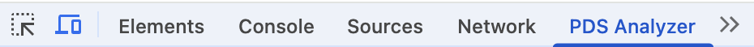
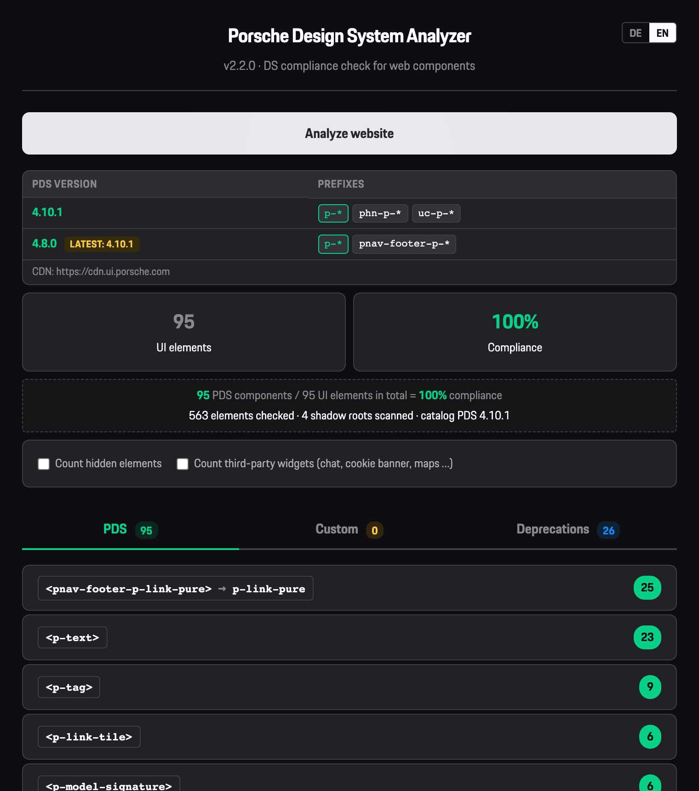

# Porsche Design System Analyzer

Chrome DevTools Extension for analyzing websites for Porsche Design System compliance. Identifies UI components and checks correct usage of the Design System.

## Download & Installation

**[⬇ Download Extension](https://github.com/porsche-design-system/porsche-design-system-analyzer/raw/main/porsche-design-system-analyzer-v2.2.0-chrome.zip)**

### Install in Chrome

1. Download and unzip the ZIP file
2. Open Chrome → `chrome://extensions`
3. Enable **Developer mode** (top right)
4. Click **"Load unpacked"** → select the unzipped folder

### Usage

1. Right-click on a website → **"Inspect"** (or `F12`)
2. Select the **"PDS Analyzer"** tab in DevTools
3. Click **"Analyze website"**



The UI is available in **English and German** (switch top right; defaults to the browser language).



## How the compliance score works

```
Compliance = PDS components / (PDS components + custom UI elements)
```

- **PDS components**: every Porsche Design System custom element on the page, including custom prefixes
  (e.g. `phn-p-button`). Sub-components such as `p-table-cell` or `p-select-option` are listed but not counted,
  so a large table does not inflate the score.
- **Custom UI elements**: native elements or ARIA patterns for which a PDS component exists
  (`<button>`, `<input type="email">`, `<select>`, `<table>`, `role="tablist"`, `role="dialog"` …),
  including elements inside open shadow roots. Natives slotted into PDS components
  (e.g. `<p-link><a></a></p-link>`) are part of the component and not counted.
- **Not counted by default**: hidden elements (`display: none`, `visibility: hidden`, screen-reader-only helpers)
  and elements inside embedded third-party widgets (chat, cookie banner, maps, social feeds). Both can be included
  via the checkboxes below the score.
- **"OK – custom is intended"** removes a single finding (or a whole group) from the score for the current analysis.

A score of **100 %** means every UI element with a PDS equivalent uses PDS. In practice **90 %+** is a good result.

The **Deprecations** tab lists PDS components and props that are deprecated in the latest PDS version
or were removed with v4 (e.g. `p-headline`, `p-text-field-wrapper`), including the replacement.

## PDS catalog

Known components, sub-components and deprecations are generated from the `component-meta` shipped with
`@porsche-design-system/components-js` (the same source as the official PDS agent skills) into
`utils/pds-catalog.json`. To update to a new PDS release:

```bash
npm install -D @porsche-design-system/components-js@latest
npm run catalog
```

Components removed in v4 are maintained in `scripts/generate-catalog.mjs`.

---

## Development

```bash
npm install
npm run dev
```

Opens Chrome with the extension and automatically navigates to porsche.com.

## Test

```bash
npm test           # Unit tests (vitest + jsdom)
npm run typecheck  # TypeScript
```

## Build & release

```bash
npm run build    # Regenerate the PDS catalog and build the extension
npm run deploy   # Build the ZIP and copy it to the repo root (updates the download link above)
```

## Technology

- [WXT](https://wxt.dev/) — Browser Extension Framework
- TypeScript, Vitest
- Chrome DevTools Panel
- `@porsche-design-system/components-js/meta` — component catalog
